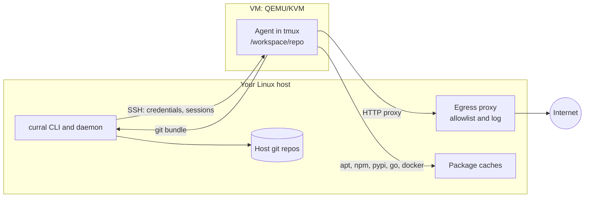

# curral

curral runs coding agents (Claude Code, opencode, pi, omp and Codex) inside QEMU/KVM
virtual machines on your Linux machine. An agent gets a full computer it can do anything
in: install packages, run code, use Docker and sudo. Your host, your credentials and
your network stay out of its reach.

## Why

Coding agents work best when they can act without asking: run the tests, install a
tool, try a fix. Letting them do that on your own machine gives them your SSH keys,
cloud credentials, browser sessions and local network. Containers share your kernel and
are usually given your files. curral gives each agent its own VM instead, and treats
everything inside it as untrusted:

- **The VM is the boundary.** No host directory is mounted, SSH is key-only with a
  pinned host key, and QEMU runs under its seccomp sandbox.
- **Nothing leaves without a rule.** By default the VM's only way out is an allowlist
  proxy on the host, plus package caches. Requests are logged, and a request to a host
  that isn't allowed is refused, or held until you allow or deny it.
- **Credentials are scoped.** An agent gets its own token, and each VM gets its own
  deploy key or token per repository, pushed at start and never baked into an image.
- **Work comes out through you.** Commits leave the VM as git bundles that the host
  checks before fetching them or opening a pull request, so the VM needs no push access.
- **Misuse is noticed.** Decoy credentials planted in the VM pause it the moment
  anything uses them.

## How it works



1. **A template** says what a VM contains: distro, CPUs and memory, packages, runtimes,
   agents, network policy and repositories. You pick it with `-t`, from sections in
   category files; by default a VM gets Docker, Node, uv, `gh` and the agents. You can
   add your own sections.
2. **A base** is built once per template: a cloud image with the template's software
   installed. Each VM is a copy-on-write overlay on its base, so creating one takes
   seconds.
3. **At each start** curral pushes the VM's credentials over SSH: agent tokens, forge
   keys or tokens, and settings. They live only in the running VM.
4. **While the agent works**, its network traffic goes through the proxy and caches on
   the host, which enforce the VM's allowlist and log every request.
5. **To get work out**, `curral pull` and `curral pr` fetch the agent's commits from the
   VM as a bundle, check it, and bring it into your repository or open a pull request.

An optional daemon handles the background work: stopping idle VMs, keeping a warm pool
of ready VMs, rebuilding bases on a schedule and relaying network prompts.

## Using curral

### Set up

Install curral and its dependencies, then store a token for your agent. The
[quick start](https://github.com/blackshieldpt/curral#quick-start) takes you from
nothing to Claude Code in a VM; [Installation](installation.md) covers signed release
binaries, building from source, optional packages and upgrades.

### Work with an agent interactively

```sh
curral up dev                 # create and start a VM with the default template
curral run dev claude         # start Claude Code in the VM's tmux session
                              # detach with Ctrl-a d; run it again to reattach
curral ssh dev                # a shell in the VM
curral cp ./notes.md dev:/tmp/
curral forward dev -L 3000    # reach a dev server in the VM from the host
curral stop dev               # shut it down, keeping its disk; curral start dev boots it again
curral destroy dev
```

`curral herdr` puts every running VM's agent in [herdr](herdr.md), which shows whether
each is working, blocked or idle. `curral up dev -t go-1.27,large` adds Go to the default
template and picks a larger size, and `--cpus`, `--mem` and `--disk` size
the VM. `curral up --ephemeral dev` gives you a VM that is destroyed when you
leave it. See [Sessions](sessions.md) for recordings and the audit log.

### Work on a repository

Register a forge once, then clone repositories into new VMs. The VM gets a deploy key
or token for that repository only.

```sh
curral forge add github --type github --host github.com --mode deploy-key --token-secret GH_ADMIN_TOKEN
curral up api --repo github:acme/api        # cloned into /workspace/api
curral run api claude
curral pull api --into ~/src/api            # fetch the agent's branch into your clone
curral pr api --into ~/src/api              # or push it and open a pull request
```

See the [GitHub tutorial](github.md) to clone and push with your SSH key and use `gh` in
the VM, and [Forges](forges.md) for Gitea, read-only keys and SSH agents.

### Control the network

A VM reaches only the hosts on its allowlist. The template sets it, and you can change
it on a running VM:

```sh
curral egress log dev -f                    # what the VM is reaching, live
curral egress allow dev pypi.org            # let it through
curral egress watch                         # answer prompts for unknown hosts
```

See [Egress](egress.md) and [Package caches](package-caches.md).

### Hand off a task

A headless task runs an agent on a prompt in a throwaway VM and brings back a pull
request, a bundle or a patch:

```sh
curral task run --repo github:acme/api --prompt "fix issue #42" --into ~/src/api
curral task ls
curral task logs <id> -f
```

See [Headless tasks](tasks.md) for batches, limits and notifications.

### Keep a safety net

```sh
curral snapshot dev before-upgrade          # memory and disk
curral restore dev before-upgrade
curral audit dev                            # what was done to the VM, and when
```

If a canary fires, the VM is paused (and you're notified, if you set up
[notifications](notifications.md)); inspect it, then
`curral resume` or `curral destroy` it. See [Canaries](canaries.md) and
[Snapshots](snapshots.md).

### Run it for the long term

```sh
curral daemon install                       # a systemd user service
curral pool ls                              # warm VMs ready for tasks
```

See [Deployment](deployment.md) for sizing, idle stop, scheduled rebuilds and headless
hosts.

## Documentation

### Getting started

- [Installation](installation.md): requirements, install, release verification, first
  VM, upgrading, building from source
- [CLI reference](cli-reference.md): every command and flag

### Using curral

- [Templates](templates.md): what a VM contains, `-t` and its sections, bases
- [Configuration](configuration.md): `config.yaml`, secrets, directories, distros
- [Agents and credentials](agents.md): Claude Code, opencode, pi, omp, Codex, MCP, transcripts
- [Forges, repos and SSH](forges.md): GitHub and Gitea, `pull` and `pr`, SSH agents,
  port forwards
- [GitHub tutorial](github.md): your SSH key for git, and a token for `gh`, step by step
- [Sessions, recordings and audit](sessions.md)
- [herdr](herdr.md): every VM's agent in herdr, with its state, resumed after restarts
- [Headless tasks](tasks.md)
- [Notifications](notifications.md)
- [Snapshots, reset and base updates](snapshots.md)

### Security

- [Security model](security-model.md): what curral protects and its limits
- [Egress](egress.md): the allowlist proxy and prompts
- [Package caches](package-caches.md)
- [Canaries](canaries.md): decoy credentials and what happens on a hit
- [Reporting vulnerabilities](https://github.com/blackshieldpt/curral/blob/master/SECURITY.md)

### Operating curral

- [Deployment](deployment.md): host sizing, the daemon, warm pool, idle stop, scheduled
  rebuilds, headless hosts, backups
- [Troubleshooting](troubleshooting.md): logs, error messages and recovery

### Contributing

- [Development](development.md): building, tests, code layout, CI and releases
- [Changelog](https://github.com/blackshieldpt/curral/blob/master/CHANGELOG.md)
